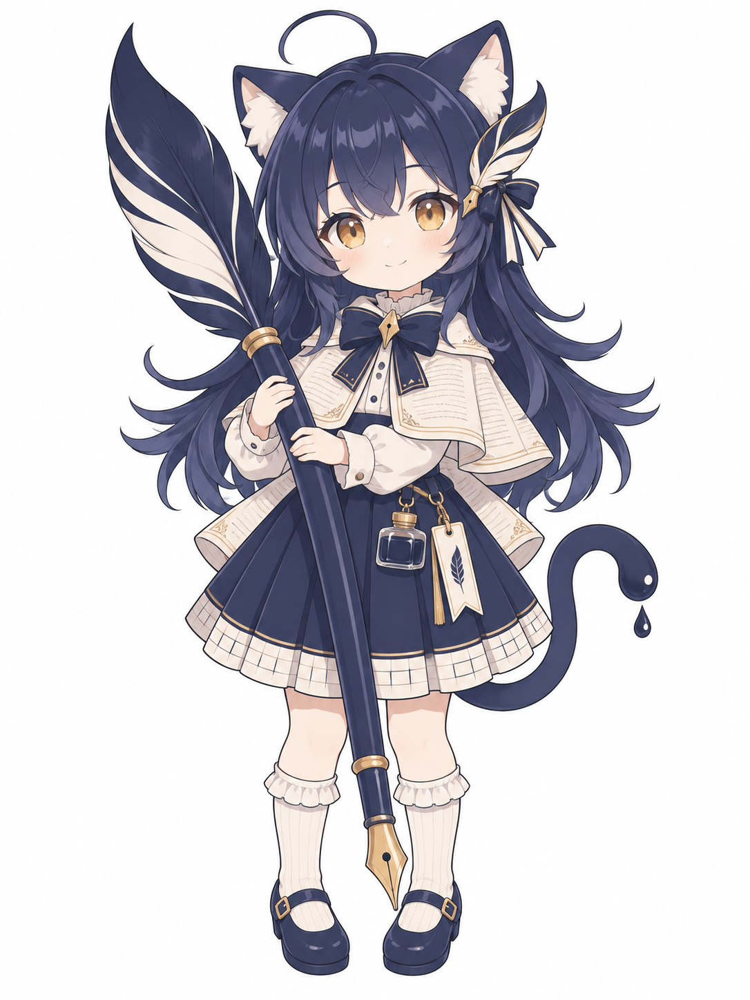
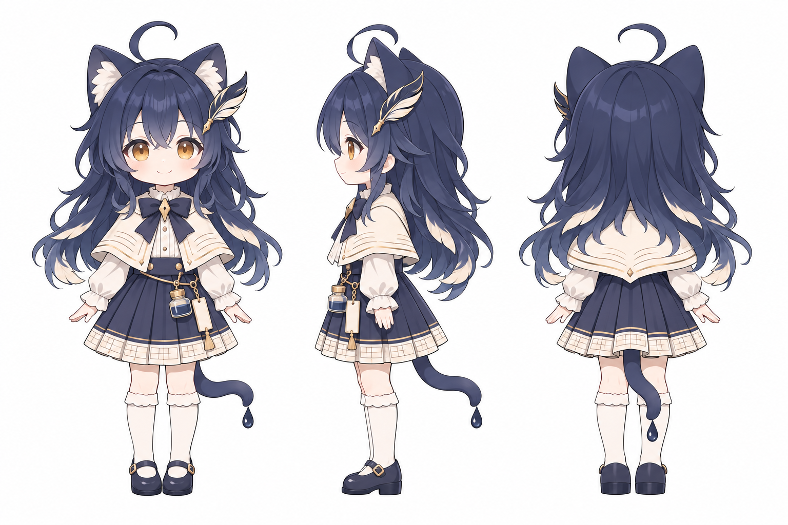
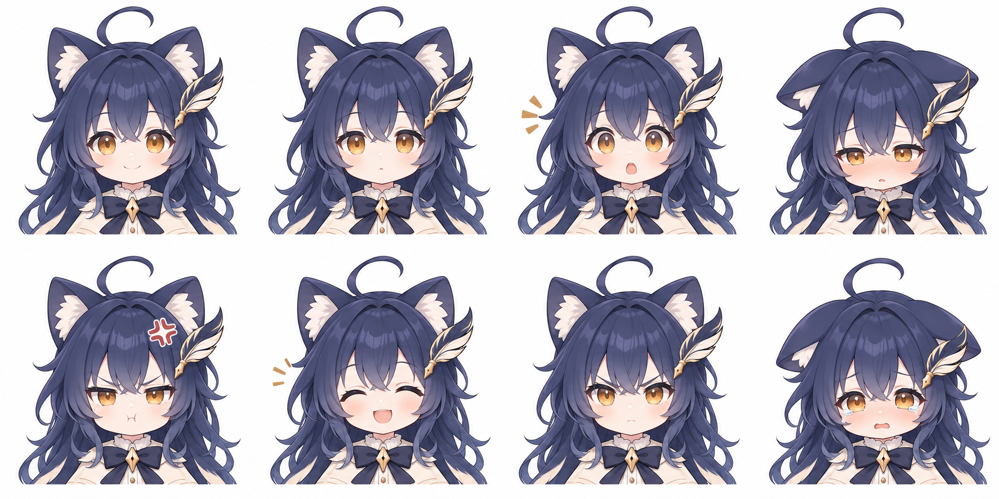
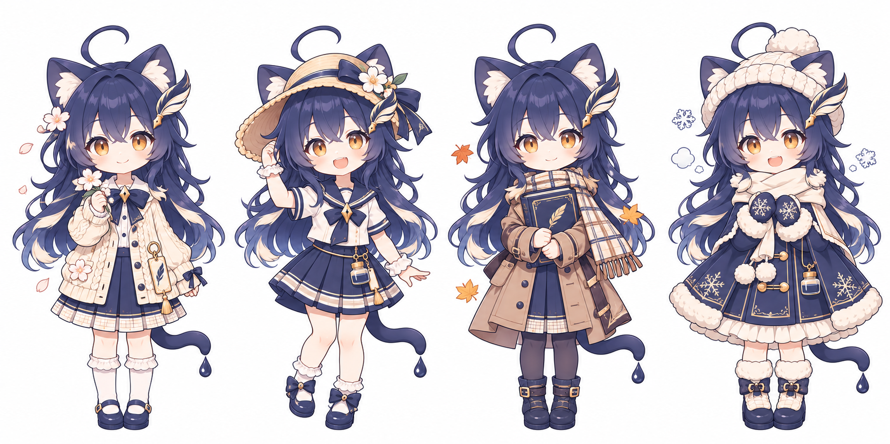

# Textus-chan · Textus 娘

The mascot of [Textus](https://textus.catvinci.com), the Markdown editor and knowledge tool by [CatVinci Studio](https://catvinci.com): a cat girl who writes with the quill from Textus's icon. This repository holds her character sheet and everything made from it - for posts, covers, stickers, the desk pet and merchandise.

[Textus](https://textus.catvinci.com) 的吉祥物：一个用 Textus 图标里那支羽毛钢笔写字的猫娘。这里是她的设定和所有物料，宣传、封面、表情包、桌宠和周边都从这里取。

## Who she is / 人设

- **Name / 名字**：Textus 娘 · Textus-chan
- **Personality / 性格**：quiet and earnest, loves writing, gets sleepy now and then, quietly happy when your writing flows. 安静认真、爱写字，偶尔犯困；你写得顺的时候她会偷偷开心。
- **Look / 外形**：ink-navy cat ears and a cat tail whose tip ends in a drop of ink; long ink-navy hair that frays into quill barbs; amber eyes; a quill-pen hair clip. 墨蓝猫耳，猫尾尖是一滴墨；墨蓝长发，发梢散成羽枝；琥珀色眼睛；羽毛钢笔发饰。
- **Outfit / 服装**：a cream academic capelet with faint page lines, an ink-navy bow with a gold nib brooch, a white blouse, an ink-navy pleated skirt hemmed with manuscript-paper squares, a little ink bottle and a bookmark at her waist, white frilled socks and ink-navy Mary Janes. 米白书页纹短斗篷、墨蓝蝴蝶结与金色笔尖胸针、白衬衫、裙摆带稿纸格的墨蓝百褶裙、腰间小墨水瓶和书签、白色荷叶边袜、墨蓝玛丽珍鞋。
- **Always with her / 随身**：a quill fountain pen taller than she is - the one in Textus's icon. 一支比她还高的羽毛钢笔，就是 Textus 图标里那支。

## Colours / 配色

| | | Hex |
|---|---|---|
| Ink navy 墨蓝 |  | `#1D2B3A` (brand), hair `#2B2D4A` |
| Paper cream 米白 |  | `#F7F2E8` |
| Warm gold 暖金 |  | `#A88D5E` |
| Amber eyes 琥珀 |  | `#D99A3A` |

## Files / 文件

| Folder | What |
|---|---|
| [`art/`](art) | The sheets: `front` (character art), `turnaround` (front, side, back), `expressions`, `outfit` (each piece), `props`, `sprites` (desk-pet poses), `seasons` (four seasonal outfits), `stickers`, `promo` (wide illustration with room for text). `art/transparent/` has each without its white background. |
| [`cutouts/`](cutouts) | Single transparent PNGs: 8 expressions, 8 poses, 8 stickers. |
| [`banners/`](banners) | Ready-made covers: X header 1500×500, WeChat cover 900×383, RedNote cover 1242×1660, GitHub social preview 1280×640, Discord banner 960×540. |

## Using her / 使用规范

- Keep her look as drawn: cat ears, ink-drop tail tip, quill hair clip, the navy-cream-gold palette. 保持原有外形和配色。
- She speaks for Textus, not for any AI company; don't show her endorsing a product or a political view. 她只代表 Textus，不代表任何 AI 公司，也不用来为其他产品或立场站台。
- Fan art, stickers and non-commercial use are welcome with credit to CatVinci Studio. 欢迎同人创作、表情包和非商业使用，请署名 CatVinci Studio。
- Merchandise for sale (prints, acrylic stands, badges, plushies…) needs our permission: open an issue or write to us. 售卖的周边（印刷品、亚克力立牌、徽章、毛绒玩具等）需要先取得我们的许可。

Her chibi stickers, together with the LLM-chan of the AI models, are also in [ChengAoShen/LLM-chan-stickers](https://github.com/ChengAoShen/LLM-chan-stickers).

## License / 授权

Original character by CatVinci Studio. The images are licensed under [CC BY-NC 4.0](https://creativecommons.org/licenses/by-nc/4.0/): share and adapt for non-commercial purposes with credit. Commercial use, including merchandise for sale, needs written permission from CatVinci Studio.

CatVinci Studio 原创角色。图片以 [CC BY-NC 4.0](https://creativecommons.org/licenses/by-nc/4.0/) 授权：署名即可非商业使用和改编；商业用途（包括售卖周边）需 CatVinci Studio 书面许可。
