

# Moyu 墨羽

**The mascot of Textus**

**English** · [简体中文](README.zh-CN.md)

Moyu ("ink feather") is the mascot of [Textus](https://textus.catvinci.com), the Markdown editor and knowledge tool by [CatVinci Studio](https://catvinci.com): a quiet, earnest and slightly chuunibyou librarian.

<table>
  <tr>
    <th width="50%">Chibi · at ease</th>
    <th width="50%">Adult · her true self</th>
  </tr>
  <tr>
    <td></td>
    <td>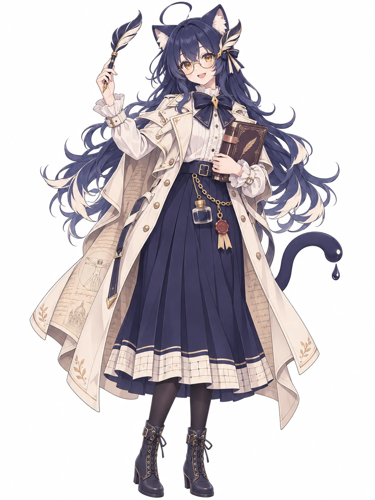</td>
  </tr>
  <tr>
    <td>How she looks at home, relaxed - the one in the desk pet.</td>
    <td>Her true self: a literature student who longs for classical writing and art.</td>
  </tr>
</table>

This repository holds her character sheet and everything made from it - for posts, covers, stickers, the desk pet and merchandise.

## Who she is

Both forms are the same girl.

- **Name:** Moyu 墨羽, "ink feather". Friends call her Mo 小墨.
- **Who:** a 175 cm literature student who works in an old bookshop.
- **Birthday:** July 8, the day Textus was first released.
- **Personality:** quiet and earnest, a little chuunibyou: her notebook is a "grimoire", her pen "the Quill Textus", and she believes that what you write down comes true. She is quietly happy when your writing flows, and hands you tea when you're stuck.
- **Look:** ink-navy cat ears; a cat tail whose tip ends in a drop of ink; long ink-navy hair that frays into quill barbs; amber eyes; a quill-pen hair clip.
- **Likes:** quill pens, wax seals, parchment, rainy days, old bookshops, black tea, writing late at night.
- **Dislikes:** documents closed without saving, garbled text, deadlines.

| | Chibi | Adult |
|---|---|---|
| **Outfit** | A cream academic capelet with faint page lines, an ink-navy bow with a gold nib brooch, an ink-navy pleated skirt hemmed with manuscript-paper squares, a little ink bottle and a bookmark at her waist, white frilled socks, ink-navy Mary Janes. | Streetwear with a long cape coat lined with manuscript script, a wax seal and an ink bottle on a chain, and round glasses she doesn't need. |
| **Always with her** | A quill fountain pen taller than she is - the one in Textus's icon. | A brass-clasped leather notebook, her "grimoire". |

Her full profile, story and catchphrases: **[STORY.md](STORY.md)**.

## Turnaround and expressions

<table>
  <tr>
    <th width="50%">Chibi</th>
    <th width="50%">Adult</th>
  </tr>
  <tr>
    <td></td>
    <td>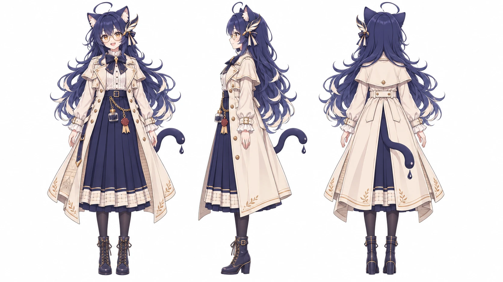</td>
  </tr>
  <tr>
    <td></td>
    <td>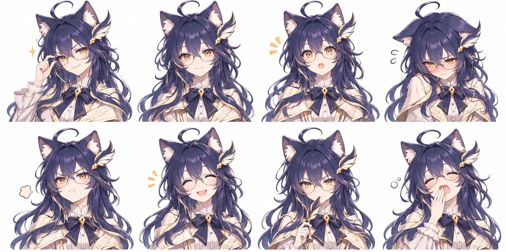</td>
  </tr>
</table>

## Four seasons

<table>
  <tr>
    <th width="25%">Spring</th>
    <th width="25%">Summer</th>
    <th width="25%">Autumn</th>
    <th width="25%">Winter</th>
  </tr>
  <tr>
    <td>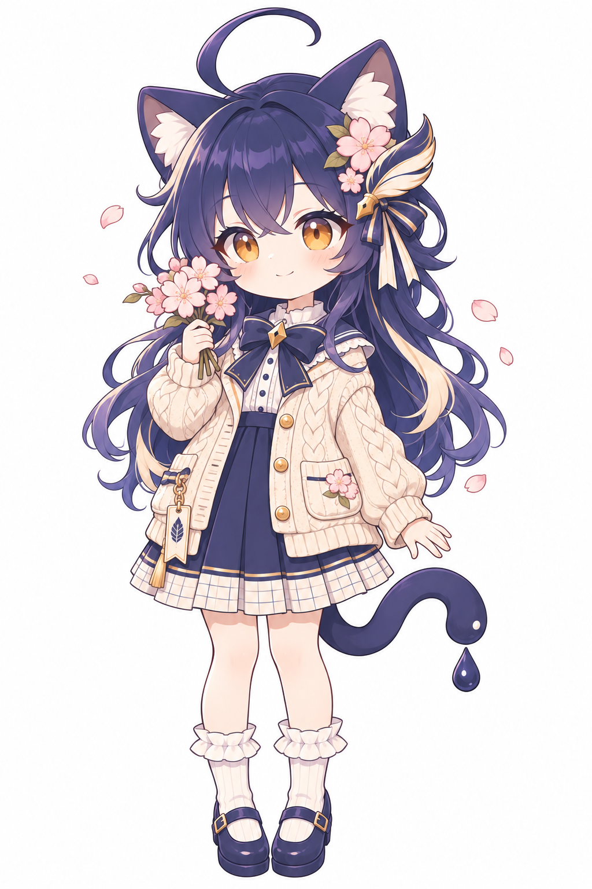</td>
    <td>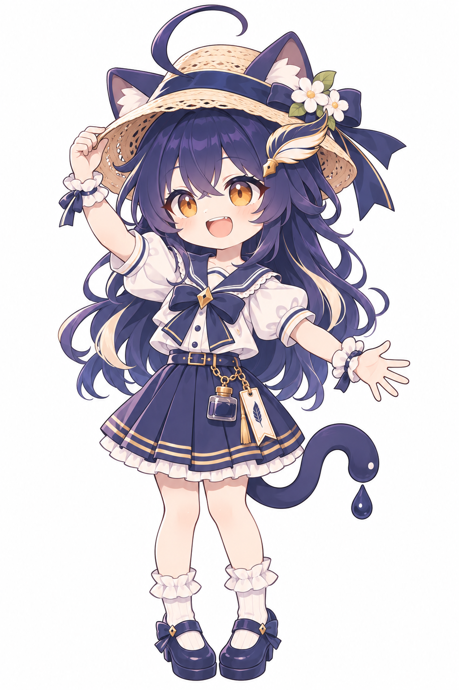</td>
    <td>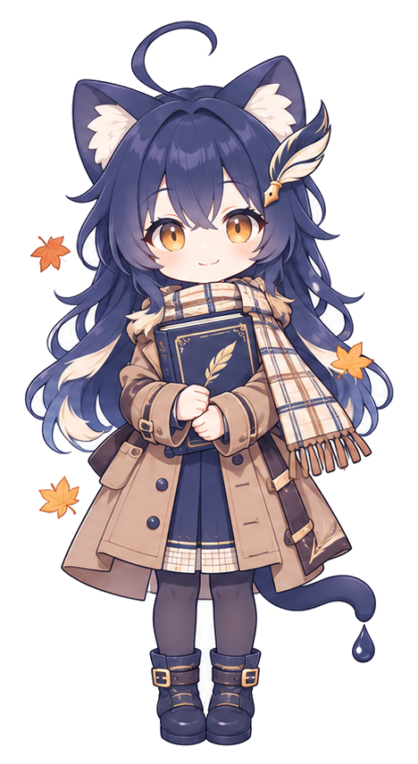</td>
    <td>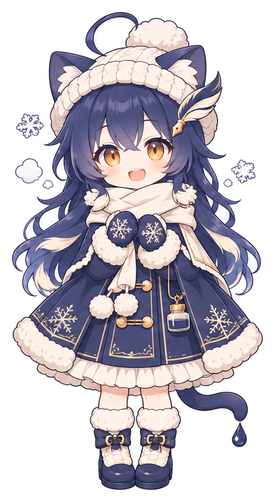</td>
  </tr>
</table>

## Outfit and props

<table>
  <tr>
    <th width="50%">Outfit</th>
    <th width="50%">Props</th>
  </tr>
  <tr>
    <td>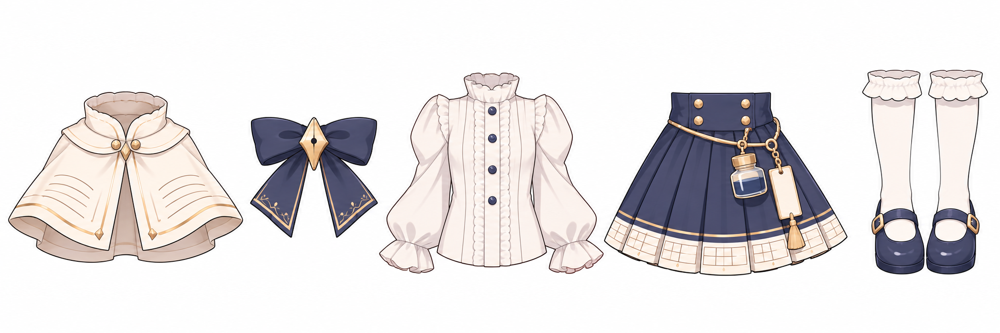</td>
    <td>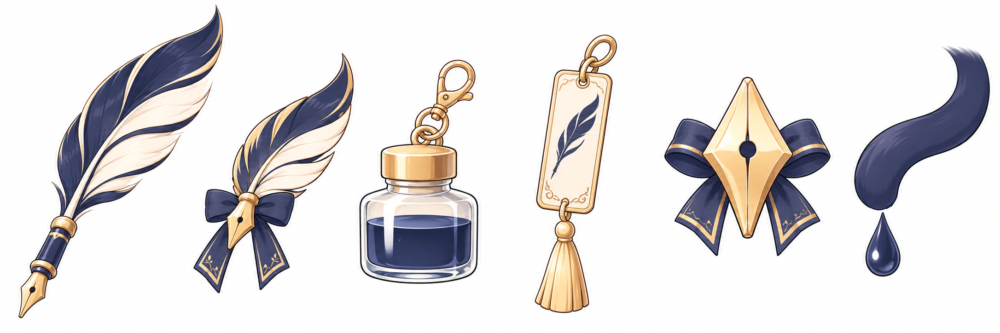</td>
  </tr>
</table>

## Stickers and poses

<table>
  <tr>
    <th width="50%">Stickers</th>
    <th width="50%">Desk-pet poses</th>
  </tr>
  <tr>
    <td>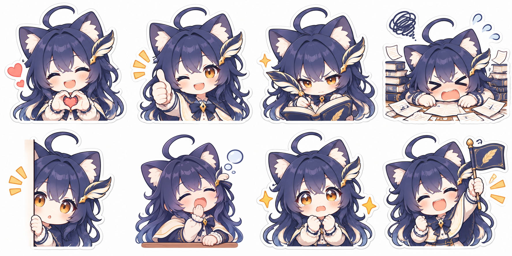</td>
    <td>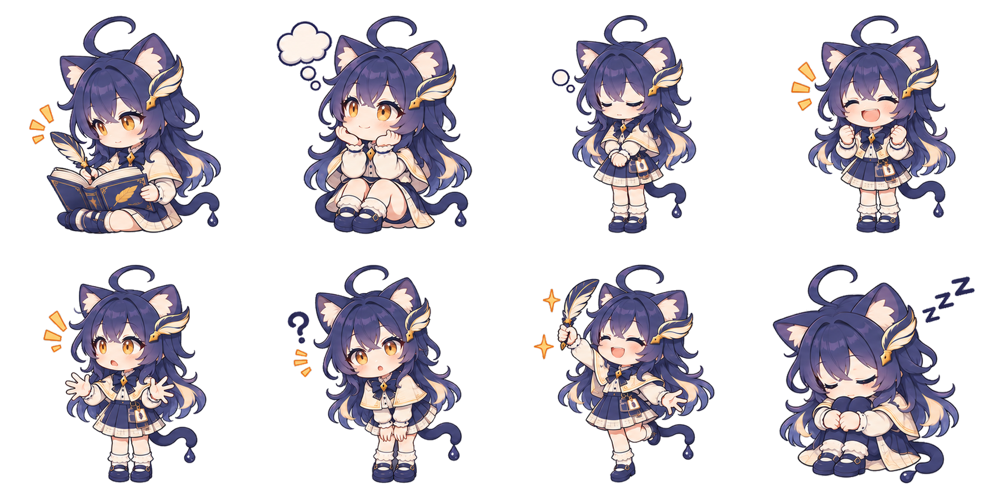</td>
  </tr>
  <tr>
    <th>Stickers with a feeling</th>
    <th>Promo illustration</th>
  </tr>
  <tr>
    <td>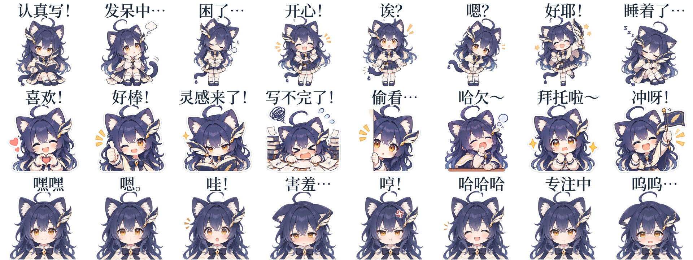</td>
    <td></td>
  </tr>
</table>

## Colours

| | | Hex |
|---|---|---|
| Ink navy |  | `#1D2B3A` (brand), hair `#2B2D4A` |
| Paper cream |  | `#F7F2E8` |
| Warm gold |  | `#A88D5E` |
| Amber eyes |  | `#D99A3A` |

## Files

| Folder | What |
|---|---|
| [`art/`](art) | The chibi sheets: `front`, `turnaround`, `expressions`, `outfit`, `props`, `sprites` (desk-pet poses), `seasons`, `stickers`, `promo` (wide, with room for text). `art/transparent/` has each without its white background. |
| [`art/adult/`](art/adult) | The adult sheets: `front`, `turnaround`, `expressions`, and `transparent/`. |
| [`art/seasons/`](art/seasons) | The four seasons one by one, at the same size, and `transparent/`. |
| [`cutouts/`](cutouts) | Single PNGs: 8 expressions, 8 poses, 8 stickers - transparent, and on white in `cutouts/white/`. The poses face right; `cutouts/left/` (and `cutouts/white/left/`) has the poses and stickers facing left. Adult expressions in `cutouts/adult/`. |
| [`cutouts/feelings/`](cutouts/feelings) | 24 stickers with a short feeling written above her in Chinese (开心！, 嗯？, 冲呀！…), facing `right/` and `left/`, each at 512 and 240 px, transparent and on white (`-white`). |
| [`banners/`](banners) | Ready-made covers: X header 1500×500, WeChat cover 900×383, RedNote cover 1242×1660, GitHub social preview 1280×640, Discord banner 960×540, RedNote profile background 1600×900, and two 1536×1024 header sources (near and wide) with the prompt that made them. |

## Using her

- Keep her look as drawn: cat ears, ink-drop tail tip, quill hair clip, the navy-cream-gold palette.
- She speaks for Textus, not for any AI company; don't show her endorsing another product or a political view.
- Fan art, stickers and non-commercial use are welcome, with credit to CatVinci Studio.
- Merchandise for sale (prints, acrylic stands, badges, plushies…) needs our permission: open an issue or write to us.

Her chibi stickers, together with the LLM-chan of the AI models, are also in [ChengAoShen/LLM-chan-stickers](https://github.com/ChengAoShen/LLM-chan-stickers).

## License

Original character by CatVinci Studio. The images are licensed under [CC BY-NC 4.0](https://creativecommons.org/licenses/by-nc/4.0/): share and adapt for non-commercial purposes with credit. Commercial use, including merchandise for sale, needs written permission from CatVinci Studio.
