

# 墨羽

**Textus 的看板娘**

[English](README.md) · **简体中文**

[Textus](https://textus.md) 的看板娘墨羽：安静认真又有一点中二的图书管理员。

<table>
  <tr>
    <th width="50%">Q 版 · 放松时</th>
    <th width="50%">成年版 · 本体</th>
  </tr>
  <tr>
    <td>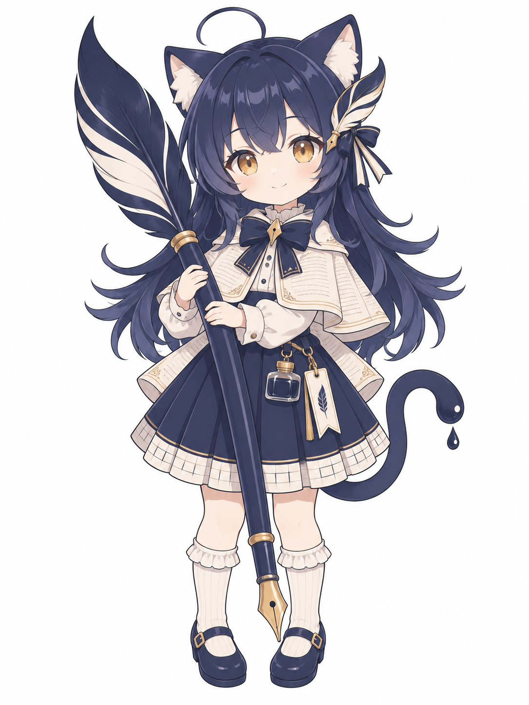</td>
    <td>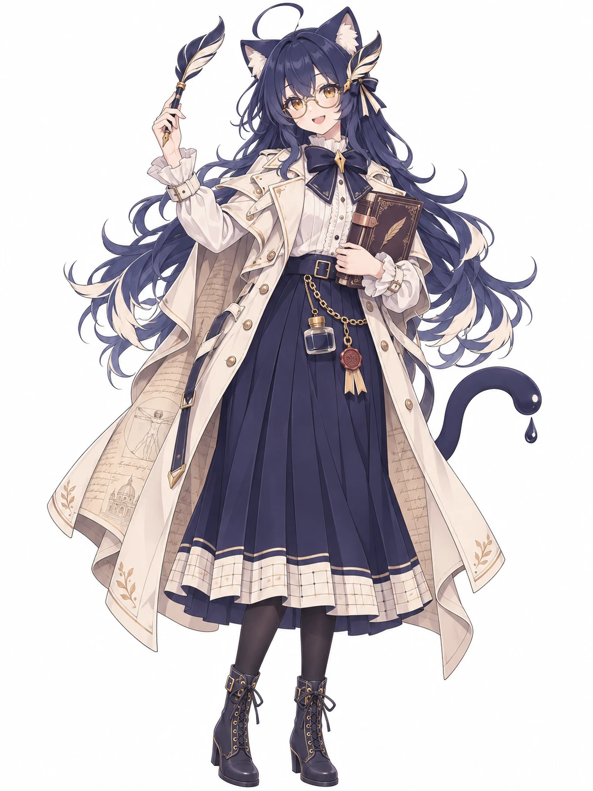</td>
  </tr>
  <tr>
    <td>回到家放松时的 Q 版形象，桌宠就是她。</td>
    <td>本体：向往古典书写与艺术的文学系大学生。</td>
  </tr>
</table>

这里是她的设定和所有物料，宣传、封面、表情包、桌宠和周边都从这里取。

## 人设

两种形态是同一个人。

- **名字：** 墨羽，朋友叫她小墨。
- **身份：** 175 cm 的文学系大学生，在旧书店打工。
- **生日：** 7 月 8 日，Textus 第一次发布的日子。
- **性格：** 安静认真，又有一点中二：笔记本是「魔导书」，钢笔是「Quill Textus」，相信写下来的事会成真。你写得顺的时候她会偷偷开心，卡住的时候她不催你，只给你递一杯茶。
- **外形：** 墨蓝猫耳；猫尾尖是一滴墨；墨蓝长发，发梢散成羽枝；琥珀色眼睛；羽毛钢笔发饰。
- **喜欢：** 羽毛笔、火漆印、羊皮纸、下雨天、旧书店、红茶、深夜写作。
- **讨厌：** 没保存就关掉的文档、乱码、截稿日。

| | Q 版 | 成年版 |
|---|---|---|
| **服装** | 米白书页纹学院风短斗篷、墨蓝蝴蝶结与金色笔尖胸针、裙摆带稿纸格的墨蓝百褶裙、腰间小墨水瓶和书签、白色荷叶边袜、墨蓝玛丽珍鞋。 | 现代街装配内衬是手稿的斗篷式长风衣，腰链挂着火漆印和墨水瓶，戴着其实不需要的圆眼镜。 |
| **随身** | 一支比她还高的羽毛钢笔，就是 Textus 图标里那支。 | 铜扣皮面笔记本，她的「魔导书」。 |

完整的人设、小故事和口头禅见 **[STORY.zh-CN.md](STORY.zh-CN.md)**。

## 三视图与表情

<table>
  <tr>
    <th width="50%">Q 版</th>
    <th width="50%">成年版</th>
  </tr>
  <tr>
    <td>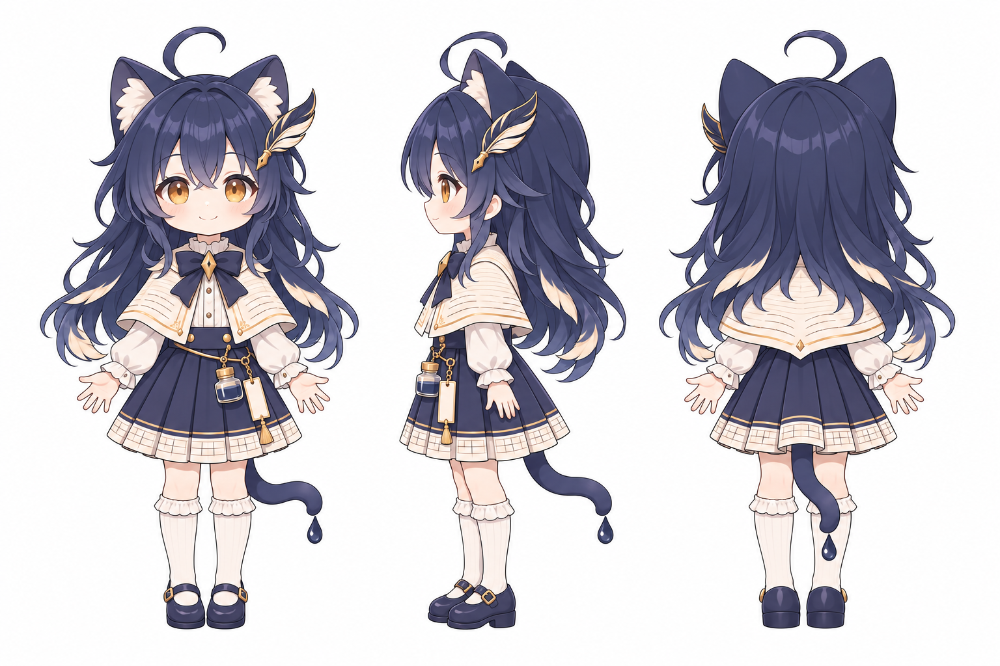</td>
    <td>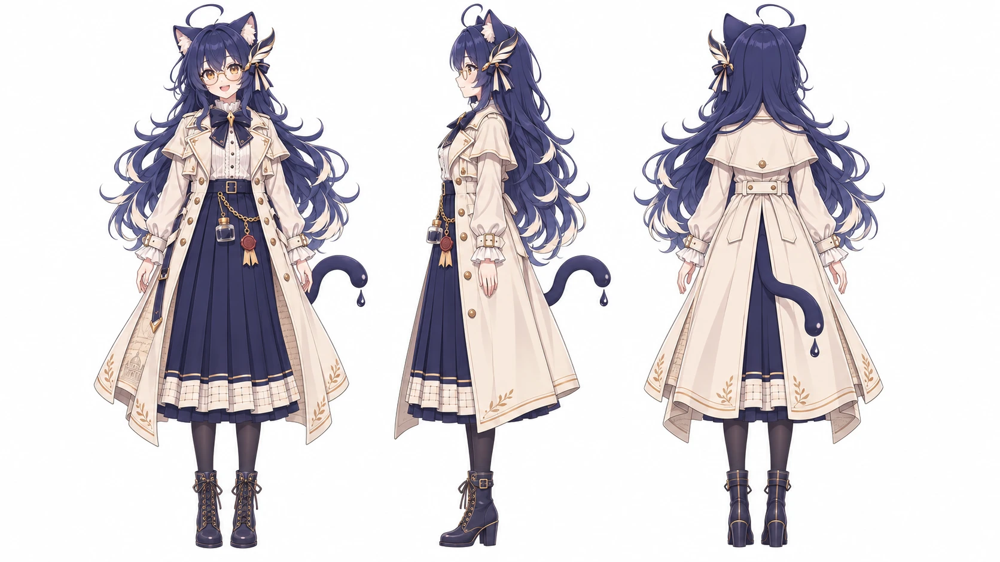</td>
  </tr>
  <tr>
    <td>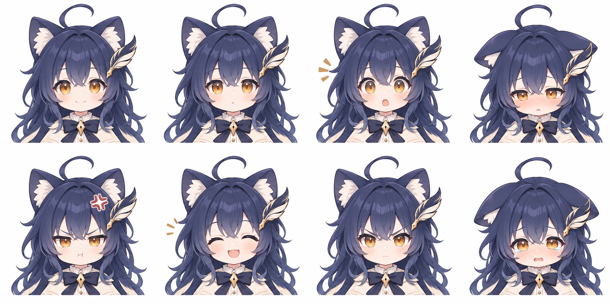</td>
    <td>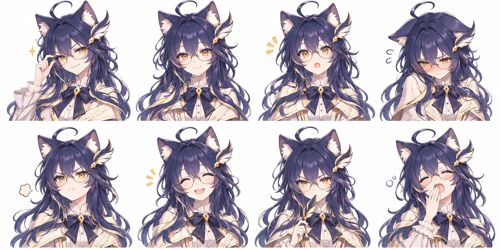</td>
  </tr>
</table>

## 四季服装

<table>
  <tr>
    <th width="25%">春</th>
    <th width="25%">夏</th>
    <th width="25%">秋</th>
    <th width="25%">冬</th>
  </tr>
  <tr>
    <td>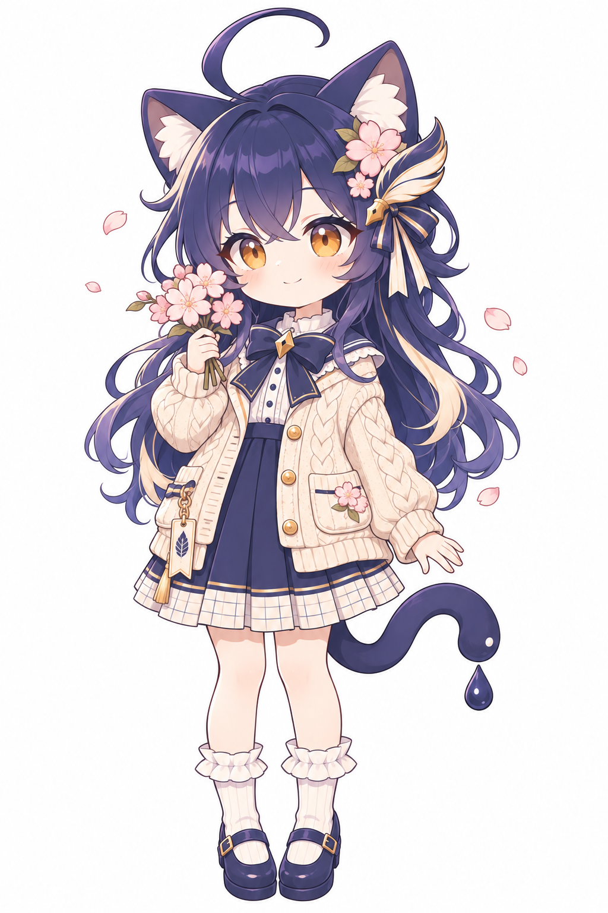</td>
    <td>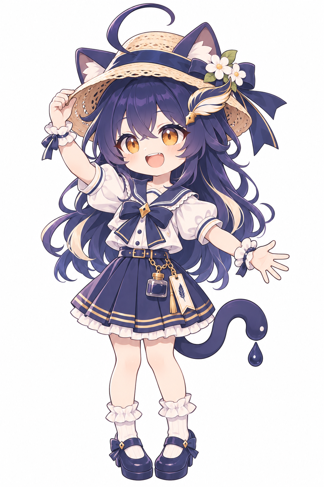</td>
    <td>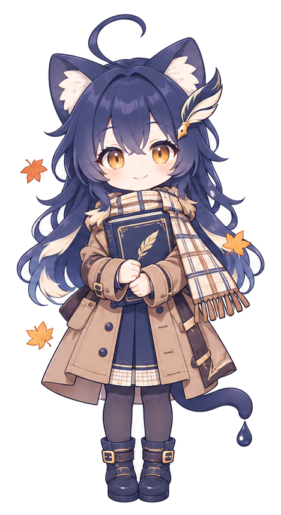</td>
    <td>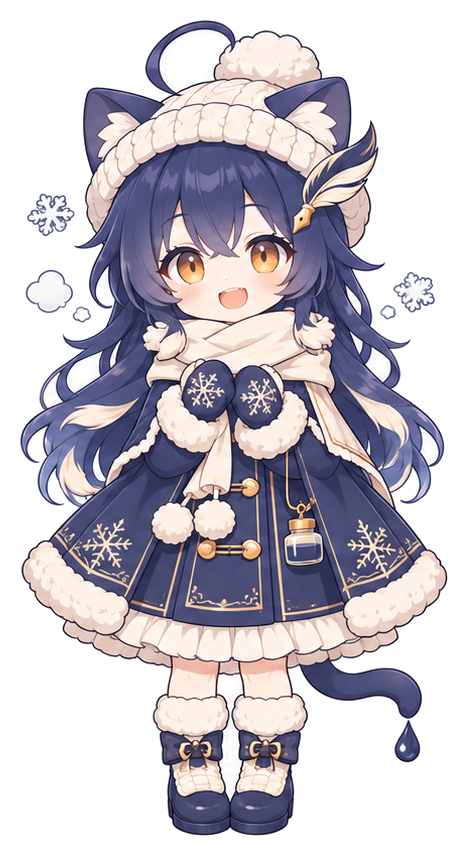</td>
  </tr>
</table>

## 服装与道具

<table>
  <tr>
    <th width="50%">服装拆解</th>
    <th width="50%">道具</th>
  </tr>
  <tr>
    <td>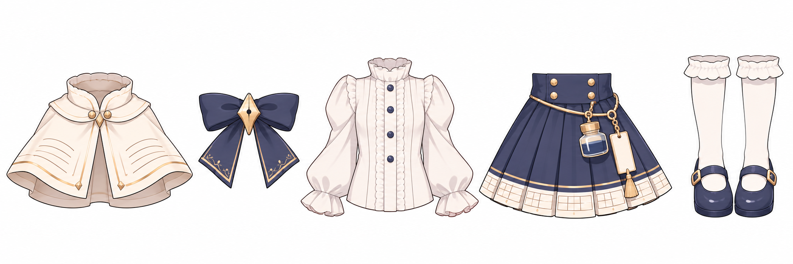</td>
    <td>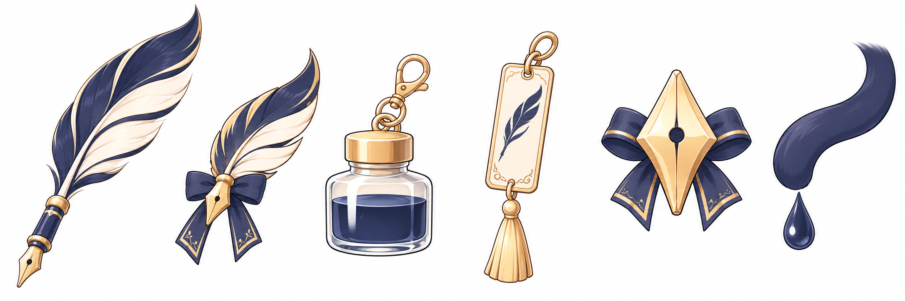</td>
  </tr>
</table>

## 表情包与动作

<table>
  <tr>
    <th width="50%">贴纸</th>
    <th width="50%">桌宠动作</th>
  </tr>
  <tr>
    <td>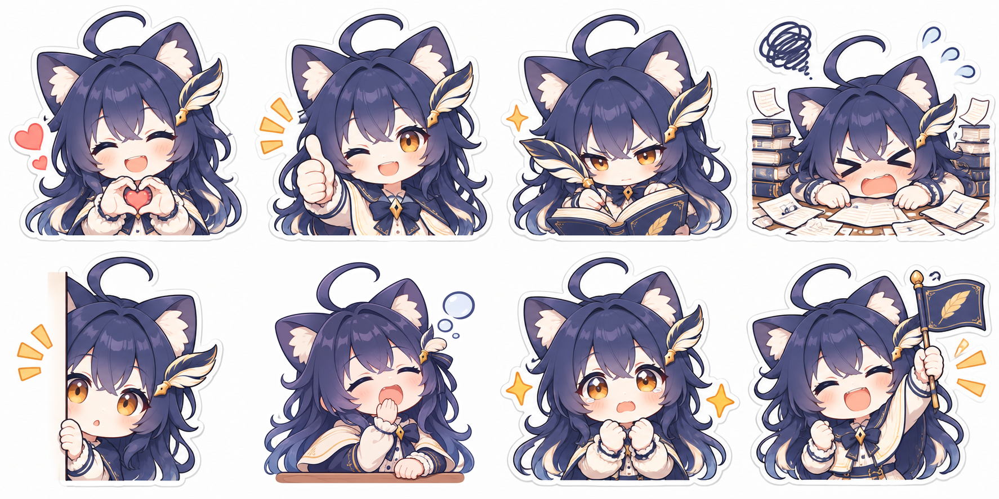</td>
    <td>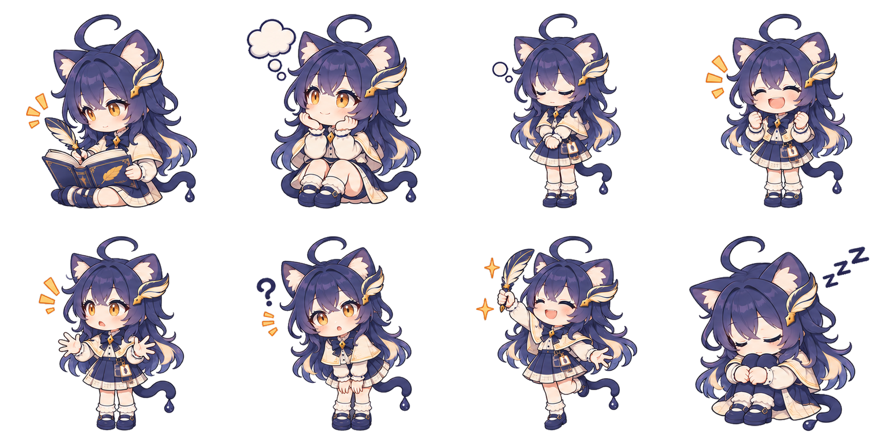</td>
  </tr>
  <tr>
    <th>带字表情包</th>
    <th>宣传插画</th>
  </tr>
  <tr>
    <td>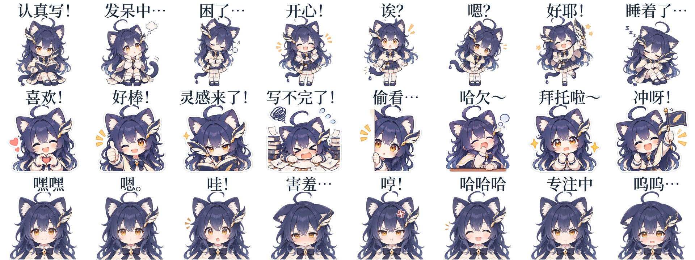</td>
    <td></td>
  </tr>
</table>

## 配色

| | | 色号 |
|---|---|---|
| 墨蓝 |  | `#1D2B3A`（品牌色），头发 `#2B2D4A` |
| 米白 |  | `#F7F2E8` |
| 暖金 |  | `#A88D5E` |
| 琥珀（眼睛） |  | `#D99A3A` |

## 文件

| 文件夹 | 内容 |
|---|---|
| [`art/`](art) | Q 版设定图：`front` 立绘、`turnaround` 三视图、`expressions` 表情、`outfit` 服装拆解、`props` 道具、`sprites` 桌宠动作（朝左）、`seasons` 四季服装、`stickers` 贴纸、`promo` 横版宣传插画（留白放文字）。`art/transparent/` 是去掉白底的版本。 |
| [`art/adult/`](art/adult) | 成年版设定图：`front`、`turnaround`、`expressions`，以及 `transparent/`。 |
| [`art/seasons/`](art/seasons) | 四季服装单张，尺寸相同，另有 `transparent/`。 |
| [`cutouts/`](cutouts) | 单张 PNG：8 个表情、8 个动作、8 张贴纸；透明背景一套，白底一套在 `cutouts/white/`。动作都朝右；朝左的动作和贴纸在 `cutouts/left/`（白底在 `cutouts/white/left/`），正面朝向观众的动作在 `cutouts/front/`（白底在 `cutouts/white/front/`）。成年版表情在 `cutouts/adult/`。 |
| [`cutouts/feelings/`](cutouts/feelings) | 带字表情包 24 张：头顶写着一句中文情绪（开心！、嗯？、冲呀！…）；`right/` 朝右、`left/` 朝左，各有 512 和 240 两种尺寸，透明底和白底（`-white`）。 |
| [`banners/`](banners) | 做好的封面：X 横幅 1500×500、公众号封面 900×383、小红书封面 1242×1660、GitHub 预览图 1280×640、Discord 横幅 960×540、小红书主页背景 1600×900，以及两张 1536×1024 的横幅原图（近景、远景）和生成它们的提示词。 |

## 使用规范

- 保持原有外形：猫耳、尾尖墨滴、羽毛笔发饰，以及墨蓝、米白、暖金的配色。
- 她只代表 Textus，不代表任何 AI 公司，也不用来为其他产品或立场站台。
- 欢迎同人创作、表情包和非商业使用，请署名 CatVinci Studio。
- 售卖的周边（印刷品、亚克力立牌、徽章、毛绒玩具等）需要先取得我们的许可：提 Issue 或联系我们。

她的 Q 版表情包和各家大模型娘一起收在 [ChengAoShen/LLM-chan-stickers](https://github.com/ChengAoShen/LLM-chan-stickers)。

## 授权

CatVinci Studio 原创角色。图片以 [CC BY-NC 4.0](https://creativecommons.org/licenses/by-nc/4.0/deed.zh-hans) 授权：署名即可非商业使用和改编；商业用途（包括售卖周边）需 CatVinci Studio 书面许可。
